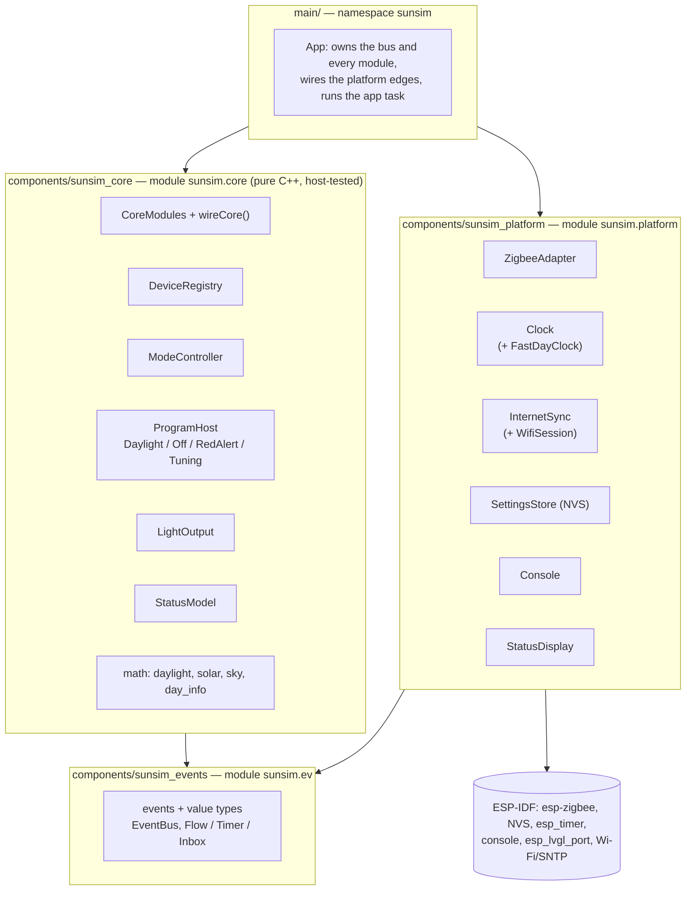
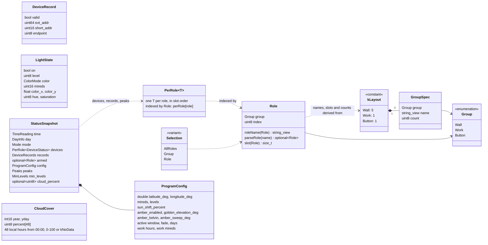
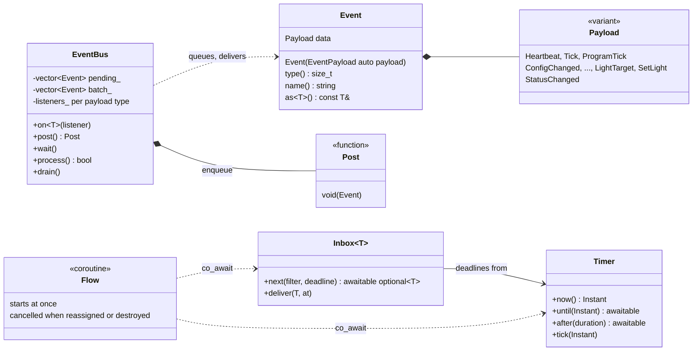
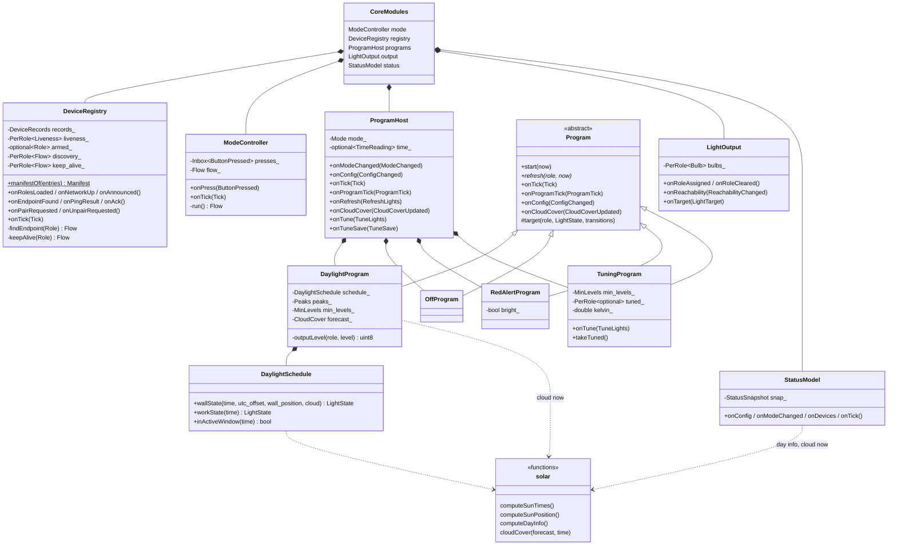
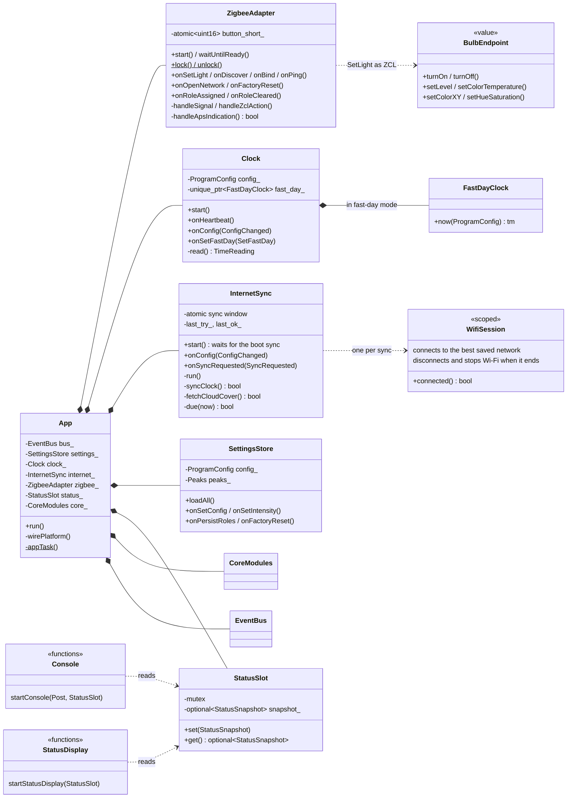
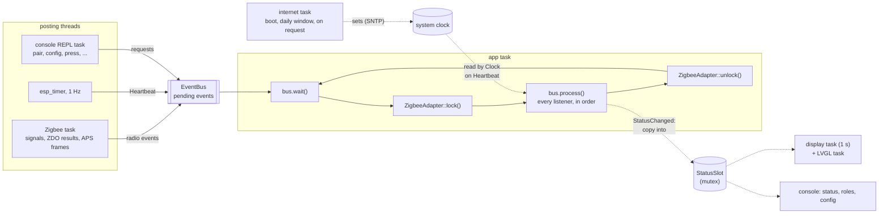
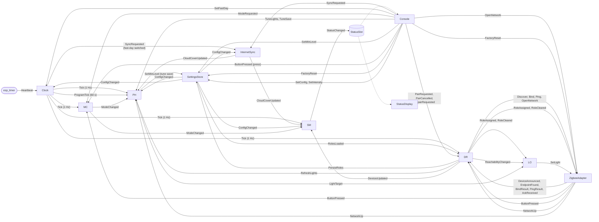
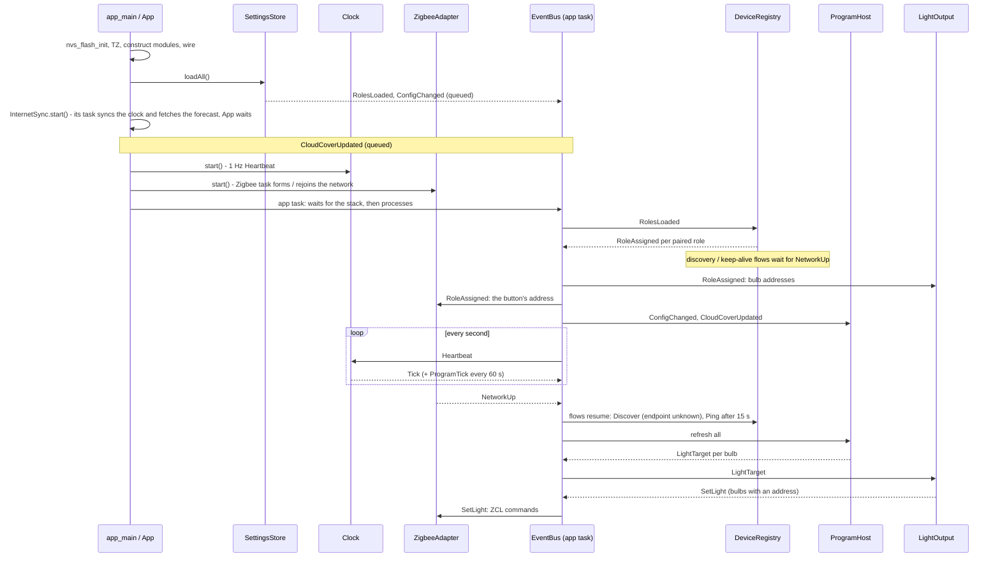
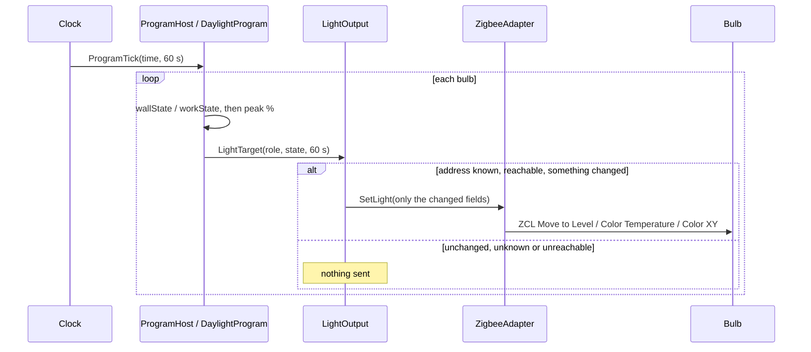
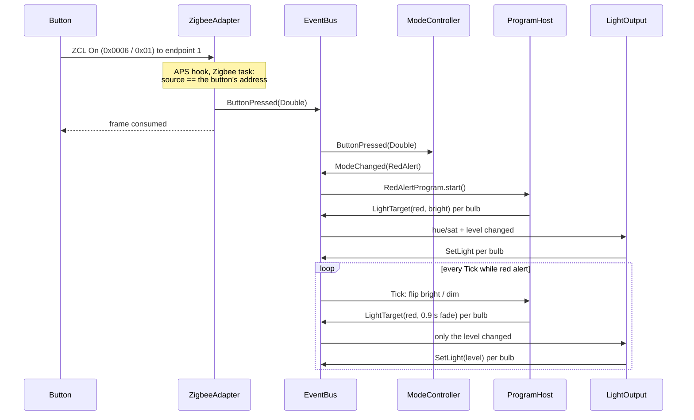

# sunsim — architecture

How the firmware is put together: the modules, the events between them,
the threads, and what happens at boot and on a button press. The domain
side (devices and roles, the button, the daylight math) is in
[DESIGN.md](DESIGN.md); building and using it in [README.md](README.md).

## 1. The rule

**Producers post events; one app task processes them.** A module never
calls another module and never takes a lock: it handles the events it's
wired to and posts new ones. Everything that touches ESP-IDF lives in
`sunsim::platform`; everything else is plain C++ in `sunsim::core` and runs
unchanged in the host tests.

This keeps every piece of application state on one thread (the app task
holds the Zigbee lock while it processes, so handlers may call the stack),
gives each module one job, and turns "what happens when..." into a chain of
events you can trace (`EventBus` logs every event at DEBUG, tag `EV`).

## 2. Layers

Each component is one C++ module (`import sunsim.ev;` ...), and ESP-IDF's
component `REQUIRES` enforce the layering: a `core` file that includes
`esp_zigbee.h` or imports `sunsim.platform` doesn't build.



| Namespace / module | Holds | Imports |
|---|---|---|
| `sunsim::ev` (`sunsim.ev`) | every event, the `Event` variant, `Post`, `EventBus`; coroutine flows (`Flow`, `Timer`, `Inbox`); value types (`Role` and the layout, `LightState`, `ProgramConfig`, `StatusSnapshot`, ...) | `std` |
| `sunsim::core` (`sunsim.core`) | `DeviceRegistry`, `ModeController`, `ProgramHost` and the programs, `LightOutput`, `StatusModel`, the daylight/solar math; `CoreModules` and `wireCore()` | `ev` |
| `sunsim::platform` (`sunsim.platform`) | `ZigbeeAdapter`, `Clock`, `InternetSync`, `SettingsStore`, the console, the status display, `StatusSlot` | `ev`, ESP-IDF |
| `sunsim` (`main/main.cpp`) | `App`, `app_main` | all |

`core` and `platform` never import each other; anything both need lives in
`ev`. File-private helpers sit in anonymous namespaces, exported internals
in `detail`.

## 3. Classes

### Value types (`sunsim::ev`, `types.cppm`)

The installation is data: `kLayout` says how many devices each group has,
and the roles, their names (`WallA`-`WallE`, `Work`, `Button`), their slots
and `PerRole<T>` are all derived from it at compile time.



`DeviceRecords` is `PerRole<DeviceRecord>`; `Peaks` (percent) and
`MinLevels` (raw level) are `PerRole<uint8_t>`. `CloudCover` is the hourly
forecast, fetched by `InternetSync` each sync.
A wall light's place on the wall is its index: light `i` of `n` sits at
`x = 1 - 2i/(n-1)`, east (+1) to west (-1).

### Events and flows (`sunsim::ev`, `events.cppm`, `bus.cppm`, `flow.cppm`)



An event's type id is its index in `Payload` (`kTypeId<T>`), so there's no
separate enum to keep in step, and `EventPayload` is the concept "one of
`Payload`'s alternatives". Every module gets a `Post` at construction:
never the bus, never another module.

### Core (`sunsim::core`)



The modules share nothing: each only knows the events it handles and what
it posts. `CoreModules` holds them, and `wireCore()` (`core.cppm`) connects
every core-to-core edge, shared by the firmware and the host tests.

### Platform and the app (`sunsim::platform`, `main/main.cpp`)



`ZigbeeAdapter` is the only code that includes esp-zigbee. It knows no
roles except the button's short address, which the APS hook needs at once
(below); `SetLight` already carries the bulb's address.

## 4. Threads



- **All module code runs on the app task.** It holds the Zigbee lock for
  the whole batch, so handlers may issue Zigbee commands directly.
- `EventBus::process()` swaps the pending events out under its mutex and
  delivers them without it, so a Zigbee callback posting (already under
  the Zigbee lock) while the app task delivers can't deadlock.
- The esp_timer only posts `Heartbeat`; `Clock` reads the time on the app
  task and posts `Tick`, so the fast-day clock can follow `ConfigChanged`
  without a lock.
- **Two deliberate shortcuts** across threads, both small:
  1. The APS hook (Zigbee task) must decide *at once* whether to consume a
     frame. `ZigbeeAdapter` keeps the button's short address in an
     `std::atomic<uint16_t>` (set from `RoleAssigned`) and posts
     `ButtonPressed` for its frames.
  2. The console's `status` and the display read the latest
     `StatusSnapshot` from `StatusSlot`, which a `StatusChanged` listener
     fills under a mutex.
- Stacks: main 6 KB, esp_timer 4.5 KB, Zigbee 6 KB, console 6 KB, app 8 KB,
  display 4 KB, internet 8 KB (TLS). An `Event` is as big as its largest payload
  (~256 bytes) and is copied a few times on the poster's stack.

## 5. Event flow

Who posts what to whom. Solid arrows are events; each label is the event
type.



| Module | Listens to | Posts |
|---|---|---|
| **ZigbeeAdapter** | `SetLight`, `Discover`, `Bind`, `Ping`, `OpenNetwork`, `FactoryReset`, `RoleAssigned`, `RoleCleared` | `NetworkUp`, `DeviceAnnounced`, `EndpointFound`, `BindResult`, `PingResult`, `AckReceived`, `ButtonPressed` |
| **DeviceRegistry** | `RolesLoaded`, `NetworkUp`, `DeviceAnnounced`, `EndpointFound`, `BindResult`, `PingResult`, `AckReceived`, `ButtonPressed`, `PairRequested`, `PairCancelled`, `UnpairRequested`, `Tick` | `RoleAssigned`, `RoleCleared`, `Discover`, `Bind`, `Ping`, `OpenNetwork`, `PersistRoles`, `RefreshLights`, `ReachabilityChanged`, `DevicesUpdated` |
| **ModeController** | `ButtonPressed`, `ModeRequested`, `Tick` | `ModeChanged` |
| **ProgramHost** (runs one `Program`) | `ModeChanged`, `ConfigChanged`, `CloudCoverUpdated`, `Tick`, `ProgramTick`, `RefreshLights`, `NetworkUp`, `TuneLights`, `TuneSave` | `LightTarget`, `SetMinLevel` (on `TuneSave`) |
| **LightOutput** | `LightTarget`, `RoleAssigned`, `RoleCleared`, `ReachabilityChanged` | `SetLight` |
| **StatusModel** | `ConfigChanged`, `ModeChanged`, `DevicesUpdated`, `CloudCoverUpdated`, `Tick` | `StatusChanged` |
| **Clock** | `Heartbeat`, `ConfigChanged`, `SetFastDay` | `Heartbeat` (from its timer), `Tick`, `ProgramTick`; on a fast-day switch also `RefreshLights`, `SyncRequested` |
| **InternetSync** | `ConfigChanged` (the sync window), `SyncRequested` | `CloudCoverUpdated` (and sets the system clock; runs on its own task) |
| **SettingsStore** | `SetConfig`, `SetIntensity`, `SetMinLevel`, `PersistRoles`, `FactoryReset` | `RolesLoaded`, `ConfigChanged` |
| **Console** | — (REPL task; reads `StatusSlot`) | the requests above |
| **StatusDisplay** | — (display task; reads `StatusSlot`) | — |

### Programs

Every mode is a `core::Program`: it decides what each bulb should show and
posts `LightTarget`s, nothing else. `ProgramHost` owns them and runs the
one the `Mode` selects.

| Hook | Called on | Daylight | Off | Red alert | Tuning |
|---|---|---|---|---|---|
| `start(now)` | `ModeChanged` | refresh all | refresh all | bright, refresh all | every bulb at its minimum, amber |
| `refresh(role, now)` | `RefreshLights`, `NetworkUp`, `ConfigChanged` | sun curve now, 2 s | off | red at the current level | the tuned / minimum level |
| `onTick` | `Tick` | — | — | flip bright/dim, 0.9 s fade | — |
| `onProgramTick` | `ProgramTick` | sun curve, ramped over the interval | — | — | — |
| `onConfig` | `ConfigChanged` (every program, running or not) | schedule, peaks, minimums | — | — | minimums, amber colour |
| `onCloudCover` | `CloudCoverUpdated` (every program) | the forecast | — | — | — |

The tuning program also takes `TuneLights` (through `ProgramHost`); on
`TuneSave`, `ProgramHost` takes its tuned levels and posts them as
`SetMinLevel`, so programs still post only `LightTarget`s.

Only the running program gets ticks and refreshes, so no program checks
the mode. `LightOutput` doesn't know programs exist: it diffs each target
against what it last sent that bulb, so switching programs sends only what
differs (daylight -> red alert: hue/sat + level; each pulse after that:
level only), and it holds back bulbs marked unreachable.

To add a program: a `Mode` (the enum, `kModes`, `modeName`), a `Program`
subclass, a member and its case in `ProgramHost::program()`, and whatever
selects it (`ModeController`, the console). Nothing else changes.

### Flows

Behaviour that happens in steps over time is a coroutine (`ev::Flow`)
rather than handlers, flags and Tick counters. `DeviceRegistry`'s endpoint
discovery, per role:

```cpp
ev::Flow DeviceRegistry::findEndpoint(ev::Role role)
{
    if (!network_up_) {
        co_await network_.next(); // roles restored at boot: ask once there's a network
    }
    for (;;) {
        const ev::Instant retry_at = timer_.now() + kDiscoveryRetry;
        post_(ev::Discover{role, record(role).short_addr});
        while (const auto found = co_await endpoints_.next(about(role), retry_at)) {
            if (found->endpoint != 0) {
                co_return endpointFound(role, found->endpoint);
            }
        }
    }
}
```

| Piece | What it is |
|---|---|
| `Flow` | a coroutine owned by its module; starts at once; reassigning or destroying it cancels it wherever it waits |
| `Timer` | `co_await timer.until(t)` / `after(15s)`; the module's `onTick` drives it, and timestamped events move it forward |
| `Inbox<T>` | `co_await inbox.next(filter, deadline)`: the next `T` the flow wants, or `nullopt` at the deadline; the module's handler calls `deliver()` |

The flows: `ModeController::run` (single vs double press by timing),
`DeviceRegistry::findEndpoint` (per role, every 15 s until found) and
`keepAlive` (per bulb: first ping 15 s after the network is up, then every
60 s; a failed ping plus 60 s of silence marks it unreachable, and it's
pinged every 15 s until it answers). The host tests run them unchanged.

## 6. Key sequences

### Boot



### Daylight update (every minute)



How the wall's targets are computed is in DESIGN.md §4.

### Button double press → red alert



Pairing a device (console `pair` or the role manifest) is in DESIGN.md §2.

## 7. Event catalogue (`events.cppm`)

| Event | Payload | Posted by |
|---|---|---|
| `Heartbeat` | — | Clock's 1 Hz esp_timer |
| `Tick` | `at` (boot time), `TimeReading` (local time, UTC offset, valid, simulated) | Clock, 1 Hz |
| `ProgramTick` | `TimeReading`, transition | Clock, every 60 s (1 s in fast-day) |
| `SetFastDay` | on, real seconds per simulated day | Console (`fastday`) |
| `SyncRequested` | — | Console (`sync`), Clock (fast-day switched) |
| `ConfigChanged` | `ProgramConfig`, per-light `Peaks` and `MinLevels` | SettingsStore (at boot, then on change) |
| `CloudCoverUpdated` | `CloudCover` (48 local hours) | InternetSync, each sync |
| `SetConfig` | `ProgramConfig` | Console (`config`) |
| `SetIntensity` | `Selection` (all, a group or a role), percent | Console (`intensity`) |
| `SetMinLevel` | `Selection`, level 1-254 | Console (`minlevel`), ProgramHost (`tune save`) |
| `ModeRequested` | `Mode` | Console (`tune`, `tune off`) |
| `TuneLights` / `TuneSave` | `Selection`, level, optional kelvin / — | Console (`tune`) |
| `RolesLoaded` / `PersistRoles` | every `DeviceRecord` | SettingsStore / DeviceRegistry |
| `NetworkUp` | rejoined, `at` | ZigbeeAdapter |
| `DeviceAnnounced` | ext addr, short addr | ZigbeeAdapter |
| `EndpointFound` | role, endpoint (0 = none) | ZigbeeAdapter |
| `BindResult` / `PingResult` | role, ok (+ error, status) | ZigbeeAdapter |
| `AckReceived` | short addr, RSSI, ZCL status | ZigbeeAdapter |
| `ButtonPressed` | `Single` / `Double` / `Hold` / `Ambiguous`, source, `at` | ZigbeeAdapter, Console (`press`) |
| `PairRequested` / `PairCancelled` | role / — | Console |
| `UnpairRequested` | `Selection` | Console |
| `OpenNetwork` | duration (s, default 180) | Console, DeviceRegistry |
| `FactoryReset` | — | Console |
| `RoleAssigned` / `RoleCleared` | role (+ `DeviceRecord`) | DeviceRegistry |
| `Discover` / `Bind` / `Ping` | role, short addr (+ ext addr, endpoint for `Bind`) | DeviceRegistry |
| `ReachabilityChanged` | role, reachable | DeviceRegistry |
| `DevicesUpdated` | per-role `DeviceStatus`, records, armed role | DeviceRegistry, 1 Hz |
| `ModeChanged` | `Mode` (`Daylight` / `Off` / `RedAlert`) | ModeController |
| `RefreshLights` | role, or every light | DeviceRegistry |
| `LightTarget` | role, `LightState`, level and colour transitions | the running program |
| `SetLight` | short addr, endpoint, optional power / level / mireds / xy / hue-sat, transitions | LightOutput |
| `StatusChanged` | `shared_ptr<const StatusSnapshot>` | StatusModel, 1 Hz |

## 8. Wiring

```cpp
// sunsim_core (core.cppm): every core-to-core edge, shared by firmware and tests.
void wireCore(ev::EventBus &bus, CoreModules &m)
{
    bus.on<Tick>([&](const Tick &e) { m.mode.onTick(e); m.registry.onTick(e); m.programs.onTick(e); m.status.onTick(e); });
    bus.on<ButtonPressed>([&](const ButtonPressed &e) { m.registry.onButtonPressed(e); m.mode.onPress(e); });
    bus.on<LightTarget>([&](const LightTarget &e) { m.output.onTarget(e); });
    // ...
}

// main (main.cpp): the platform edges.
void App::wirePlatform()
{
    bus_.on<SetLight>([this](const SetLight &e) { zigbee_.onSetLight(e); });
    bus_.on<PersistRoles>([this](const PersistRoles &e) { settings_.onPersistRoles(e); });
    bus_.on<StatusChanged>([this](const StatusChanged &e) { status_.set(*e.snapshot); });
    // ...
}
```

Listeners are added while wiring, before anything is processed, and run in
the order they were added.

## 9. Testing

`test/host/` builds `sunsim.ev` and `sunsim.core` with plain CMake on the
PC (no ESP-IDF; exceptions and RTTI off like the firmware), wires them with
the same `wireCore()`, and asserts on everything posted in response to the
events each test posts:

```
./sunsim test
```

Covered: console pairing end to end; a paired device is never re-claimed by
`pair`; unknown devices ignored; double press -> red pulses -> single press
re-syncs; hold -> all off; ambiguous On/Toggle timing; clock-not-set holds
lights off; per-light intensity; liveness (acks -> online, silence ->
silent, pings, an unanswered ping counts as failed); discovery retry and
unpairing stopping it; button pairing binds; `unpair all` and unpairing a
group; the role layout; the wall dimming in order away from the sun; the
name-keyed role manifest; the amber sweep across the wall at sunset; the
cloud forecast lookup and its overlay (dimmer, cooler, diffuse); minimum
levels keeping the wall lit to sunset; tuning mode and `tune save`; the
bus delivering 40k events from two threads in each poster's order.

## 10. The EventBus

- Standard library only (`bus.cppm`): a `std::mutex`-guarded vector of
  pending events, a `std::condition_variable` for `wait()`, and a
  `std::function` list per payload type.
- `process()` swaps the pending events out and delivers them without the
  mutex, so posters never block on listeners. The two vectors keep their
  capacity, so nothing allocates once warmed up.
- `StatusChanged` carries a `shared_ptr` because it's by far the largest
  payload and every `Event` is as big as its largest alternative.
- ThreadSanitizer can't run: GCC 15's `std` module doesn't build with
  `-fsanitize=thread`.

## 11. History

- The code started as a few large classes (`LightRig` did pairing,
  discovery, liveness, scheduling, intensity and Zigbee output) reached
  from six threads under hand-placed Zigbee locks. The event bus replaced
  that in one branch; NVS keys stayed the same, so pairings carried over.
- Since then: every mode became a `Program` (red alert used to be split
  across the mode controller and the output); missing bulbs are tolerated
  (an unreachable bulb used to tie up the stack's buffers with retries);
  multi-step behaviour moved into coroutine flows; the components became
  C++ modules; the bus wrapped eventpp until clangd couldn't build it next
  to `import std`, and is now its own (under 100 lines); roles became groups
  (`kLayout`) for the five-light wall.
- Considered and rejected: ESP-IDF's `esp_event` (C-only, memcpy'd POD
  payloads, no host build).

## 12. Open questions

- One queue is ample at a few events a second; should time-critical
  `SetLight` traffic ever bypass the rest?
- NVS writes happen on the app task while it holds the Zigbee lock; fine at
  today's rates.
- `DevicesUpdated` (~250 B) now sets every `Event`'s size; share it like
  `StatusChanged` if events grow further.
- A presence sensor is planned to replace the fixed active window; the gate
  in `DaylightSchedule` is the place it plugs in.
