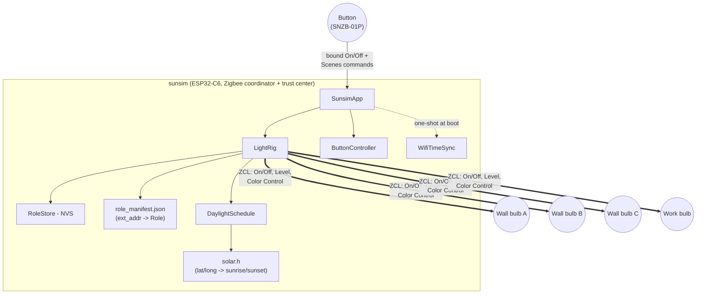
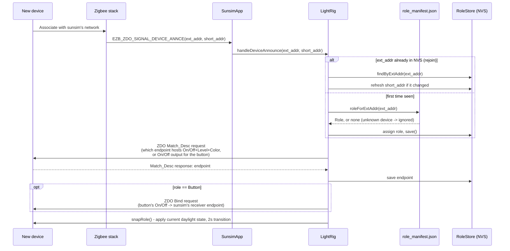
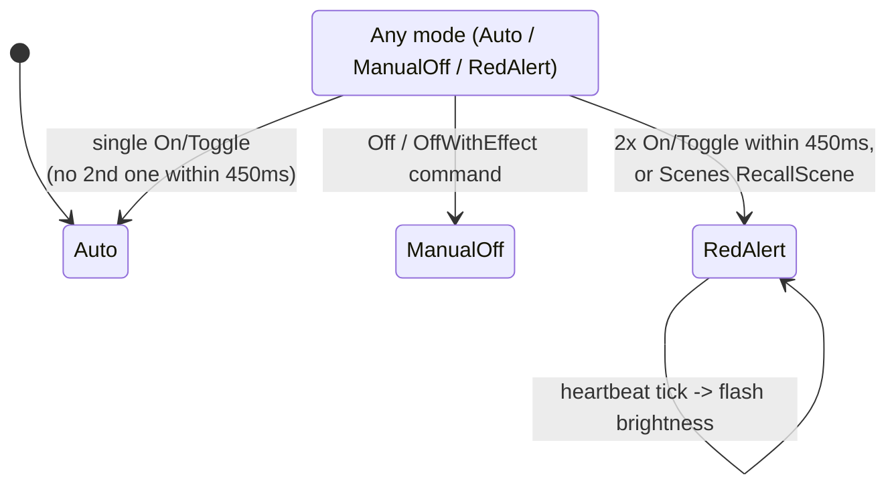

# sunsim — Design

Architecture, addressing, and the math behind the daylight program. For
build/pairing/configuration instructions, see [README.md](README.md).

## 1. System overview



`SunsimApp` is the only stateful singleton; it owns a `LightRig` (the 5
paired devices, their roles, and the daylight program) and a
`ButtonController` (a pure state machine, decoupled from Zigbee via
callbacks). `WifiTimeSync` runs once at boot to get a correct clock over
SNTP, then shuts Wi-Fi off so it doesn't contend with the 802.15.4 radio.

## 2. Device addressing & role assignment

Each device carries two addresses and exposes a role through none of them
directly — see the table below, then the join sequence.

| Identifier | Size | Origin | Stable? |
|---|---|---|---|
| `ext_addr` (IEEE/EUI-64) | 64-bit | Burned in at manufacture; printed as a barcode/QR on the device/box | Yes — never changes |
| `short_addr` (NWK address) | 16-bit | Assigned by sunsim (the trust center) when the device associates | No — can change on every rejoin |
| `endpoint` | 8-bit | Discovered via a ZDO Match_Desc query, not announced by the device | Fixed per device/firmware, but not knowable up front |

Role (`WallA`/`WallB`/`WallC`/`Work`/`Button`) comes from none of these —
it's a lookup of `ext_addr` against the static table in
[`main/role_manifest.json`](main/role_manifest.json), filled in by hand from each
device's label before deployment. This replaced an earlier join-order
scheme (first device seen -> first role) that made pairing order load-bearing
and fragile.



`short_addr` is deliberately never put in the manifest or treated as
stable — it's refreshed from the announce signal every time, exactly as a
network-assigned address should be.

### Finding `ext_addr` when the device has no visible label

Not every bulb prints its IEEE address anywhere accessible. Since an
unrecognized device is rejected rather than silently assigned a role (see
`roleForExtAddr` returning `std::nullopt` above), its join attempt logs the
exact address you need:

```
W (12345) LIGHT_RIG: Ignoring unknown device 0x1a2b (ext=0x00124b00223344aa): not in role manifest
```

Workflow: open `idf.py monitor`, put one bulb into pairing mode at a time
(so you know which log line is which physical device), copy the `ext=`
value into the right slot in `role_manifest.json`, rebuild/reflash, then
re-trigger pairing on that bulb so it rejoins and matches.

## 3. Button input handling

The SNZB-01P (and most simple single-button switches) only exposes its
clicks through the standard On/Off cluster. esp-zigbee-lib resolves the
standard `On`/`Off`/`Toggle` commands internally and only surfaces the
*resulting attribute value* to the app (`EZB_ZCL_CORE_SET_ATTR_VALUE_CB_ID`)
— there is no API-level way to tell `On` and `Toggle` apart. So single vs.
double press is resolved by **timing** on that boolean, not by command
type; `Off`/`OffWithEffect` and a Scenes `RecallScene` command are each
unambiguous and handled directly.



The debounce window (450ms, `ButtonController`'s `double_click_window_`) is
resolved on the next heartbeat tick, not by its own timer — see
`ButtonController::tick()`.

## 4. Daylight mathematical model

No Zigbee or hardware dependency in either piece below (`main/daylight.cpp`,
`main/solar.cpp`) — both are pure functions, unit-testable on the host.

### Wall bulbs (`DaylightSchedule::wallState`)

The window the half-sine curve runs across is now the **real** sunrise/
sunset for the configured location and date, not a fixed clock-time guess.
Let `h` be the fractional hour of day (`hour + minute/60 + second/3600`),
`sunrise`/`sunset` the result of `computeSunTimes()` (§5) for today, and
(if `sunset <= sunrise`, i.e. the window spills past local midnight —
see the near-polar-summer case in §5) unwrapped onto a continuous scale.
Off outside `[sunrise, sunset]`; inside it:

```
p = (h - sunrise) / (sunset - sunrise)      # 0..1 progress through today's daylight window
b = sin(π · p)                              # 0 at sunrise/sunset, 1 at solar noon

level  = round(b · max_level), floored to min_level
mireds = round(warm_mireds - b · (warm_mireds - cool_mireds))
```

`b` is a half-sine: it starts and ends at 0 (sunrise/sunset) and peaks at 1
exactly at the window's midpoint ("solar noon" for that day's actual window
length). Brightness (`level`) scales directly with `b`; color temperature
(`mireds`) is a linear interpolation between `warm_mireds` at the edges
(`b=0`) and `cool_mireds` at the peak (`b=1`) — lower mireds is
cooler/bluer, so the light goes warm-and-dim at the edges to
cool-and-bright at midday, and the whole curve stretches or compresses
with the real day length through the year.

Defaults: `warm_mireds=370` (~2700K), `cool_mireds=153` (~6500K),
`min_level=1`, `max_level=254`.

### Work bulb (`DaylightSchedule::workState`)

Bright, and **cool to warm** across the core work hours (`work_start_hour`
to `work_end_hour`, default 08:30-17:30, inside the longer 08:00-19:00
active window it's on for) rather than tied to the sun: cool, blue-rich light in the morning supports alertness and
circadian entrainment, while blue-rich light in the evening suppresses
melatonin and delays sleep (cf. the evening-light guidance in Brown et
al., PLOS Biology 2022). With `p` the progress through the work hours (so it holds cool before
them and warm after):

```
p      = clamp((h - work_start) / (work_end - work_start), 0, 1)
level  = gate · max_level
mireds = work_cool_mireds + p² · (work_warm_mireds - work_cool_mireds)
```

Defaults: `work_cool_mireds=167` (~6000K), `work_warm_mireds=333`
(~3000K). The ease-in (`p²`) keeps it near-cool through the morning
(~5200K at noon) and warms most steeply in the afternoon (~3900K at
15:00), reaching ~3000K at 17:30 and holding there until the light turns
off. Interpolating in mireds rather than kelvin
keeps the steps perceptually closer to even.

### Per-light peak intensity (`LightRig::setPeakPercent`)

After the schedule computes a bulb's level, `LightRig` scales it by that
light's peak percentage (`intensity` console command, NVS key
`<role>.peak`, defaults walls 100 / work 90):

```
level_out = max(1, round(level · peak / 100))
```

So `peak` is the brightness at the curve's maximum (solar noon for wall
bulbs, mid-window for the work bulb), and every other point scales in
proportion. Colour temperature is untouched; red alert is not scaled.

### Active window (`DaylightSchedule::activeGate`)

Both bulb types are gated by one shared window, set with the `config`
console command and persisted in NVS (`main/schedule_settings.*`):
on only on `active_days` (default Mon–Fri) between `active_start_hour` and
`active_end_hour` (default 08:00–19:00), off otherwise. Inside it, a gate
factor ramps over `fade_minutes` (default 10) at each edge:

```
gate = 0                                               outside days/hours
gate = min(1, (h - start)/fade, (end - h)/fade)        inside
level_out = round(gate · level), floored to min_level while gate > 0
```

Only brightness is scaled; color temperature still follows the sun. The
sun curve still applies inside the window, so in winter the wall bulbs go
dark at real sunset even before `active_end_hour`.

## 5. How location is provided

Two independent, decoupled pieces feed into the wall bulbs' sunrise/sunset
calculation — no GPS, just two numbers you configure once:

1. **Latitude/longitude** (`CONFIG_SUNSIM_LATITUDE_DEG`/
   `CONFIG_SUNSIM_LONGITUDE_DEG`, decimal degrees, North/East positive) —
   set via `menuconfig`, parsed with `strtod()` in `SunsimApp`'s
   constructor, and stored in `DaylightSchedule::Config`.
2. **Local civil UTC offset** — needed alongside longitude because the
   calculation has to know which UTC instant "today, local time" actually
   is. `WifiTimeSync` syncs the clock to UTC over SNTP once at boot; from
   there, `LightRig::currentUtcOffsetHours()` derives the offset in effect
   *today* (DST included) without a portable `tm_gmtoff` field (not
   available on this toolchain's `struct tm` — confirmed by test
   compile): it takes the current instant, reads its UTC calendar fields
   via `gmtime_r`, then feeds those same field values back through
   `mktime()` — which interprets them as *local* time under the process's
   `TZ` (`CONFIG_SUNSIM_TZ`) — and the difference between the two
   `time_t`s is the local UTC offset.

`main/solar.cpp` implements the "Sunrise/Sunset Algorithm" from the
*Almanac for Computers, 1990* (Nautical Almanac Office, US Naval
Observatory) — the standard non-iterative closed-form approximation used
by most embedded sunrise/sunset libraries (accurate to within a couple of
minutes). Given latitude, longitude, day-of-year (`tm_yday + 1`), and the
UTC offset above, it returns local sunrise/sunset as fractional hours.
Validated on the host against known reference times before wiring it in
(equinox ≈ 06:00/18:00 everywhere; London ≈ 04:43/21:21 at the summer
solstice and ≈ 08:04/15:53 at the winter solstice; Reykjavik's much longer
summer days and short winter days; Southern-hemisphere seasons correctly
inverted).

At latitudes inside the polar circle, the day can have no sunrise/sunset at
all, or the sunset can land after local midnight (summer, very long day).
`solar.cpp` clamps the underlying angle rather than leaving a domain error
(degenerates to an always-off or always-on day instead of propagating NaN
into bulb commands); `daylight.cpp`'s window math unwraps a
`sunset <= sunrise` case onto a continuous scale so hours just after
midnight are still correctly treated as part of the previous evening's
daylight window.

Work hours (§4) remain fixed local-clock thresholds, by design — they're
your work schedule, not a daylight simulation, so there's nothing to
compute.

## 6. Smooth transitions

Every periodic update (`LightRig::applyAllBulbs`, driven by the heartbeat
timer) sends level/color-temperature commands with a transition time equal
to the tick interval (60s normally, 1s in debug fast-day mode), so bulbs
fade continuously rather than stepping. Explicit state changes that should
feel immediate — resuming after an override, a bulb finishing discovery, a
reboot — use a fixed 2s transition instead (`LightRig::snapRole`/
`snapAllBulbs`).

## 7. File layout

See the [Layout section in README.md](README.md#layout).
