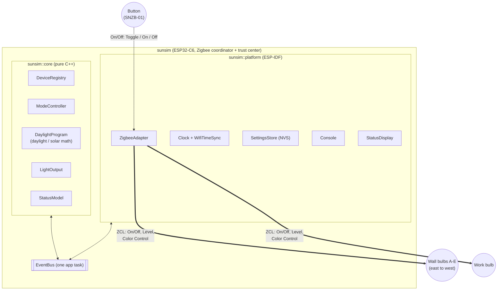
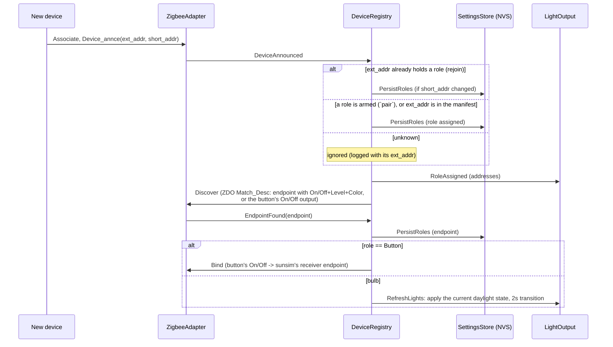
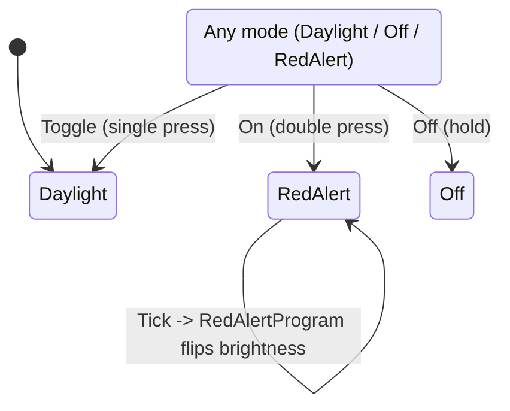

# sunsim — Design

Architecture, addressing, and the math behind the daylight program. For
build/pairing/configuration instructions, see [README.md](README.md).

## 1. System overview



Every module talks only through events on one `EventBus`
([eventpp](https://github.com/wqking/eventpp)); a single app task processes
them while holding the Zigbee lock, so no module takes locks or calls
another. `sunsim::core` holds all application logic and builds on the host
(`test/host`); `sunsim::platform` is everything that touches ESP-IDF.
[EVENT_DESIGN.md](EVENT_DESIGN.md) has the full architecture: layers,
threading, the event catalogue, and key flows. `WifiTimeSync` syncs the
clock over SNTP at boot (before the radio starts), then retries/resyncs
on a background task.

## 2. Device addressing & role assignment

Each device carries two addresses and exposes a role through none of them
directly — see the table below, then the join sequence.

| Identifier | Size | Origin | Stable? |
|---|---|---|---|
| `ext_addr` (IEEE/EUI-64) | 64-bit | Burned in at manufacture; printed as a barcode/QR on the device/box | Yes — never changes |
| `short_addr` (NWK address) | 16-bit | Assigned by sunsim (the trust center) when the device associates | No — can change on every rejoin |
| `endpoint` | 8-bit | Discovered via a ZDO Match_Desc query, not announced by the device | Fixed per device/firmware, but not knowable up front |

Role (`WallA`-`WallE`, `Work`, `Button`: a group and an index within it,
`ev::Role`, with the counts per group in `ev::kLayout`) comes from none of these.
It's assigned when the device joins: to the role armed with the console's
`pair <role>` (if the device doesn't already hold one), or else by looking
up `ext_addr` in the optional build-time table
[`main/role_manifest.json`](main/role_manifest.json). Pairing order never
matters.



`short_addr` is deliberately never put in the manifest or treated as
stable — it's refreshed from the announce signal every time, exactly as a
network-assigned address should be.

### Finding `ext_addr` when the device has no visible label

Not every bulb prints its IEEE address anywhere accessible. Since an
unrecognized device is rejected rather than silently assigned a role (see
`roleForExtAddr` returning `std::nullopt` above), its join attempt logs the
exact address you need:

```
W (12345) LIGHT_RIG: Ignoring unknown device 0x1a2b (ext=0x00124b00223344aa): not in role manifest
```

Workflow: open `idf.py monitor`, put one bulb into pairing mode at a time
(so you know which log line is which physical device), copy the `ext=`
value into the right slot in `role_manifest.json`, rebuild/reflash, then
re-trigger pairing on that bulb so it rejoins and matches.

## 3. Button input handling

The SNZB-01-style button tells us which press it was through the standard
On/Off cluster: single = `Toggle`, double = `On`, hold = `Off`. It sends
these to the coordinator's endpoint 1 (our light-control endpoint, which
has no On/Off server) whatever the binding says, so the stack would drop
them. `ZigbeeAdapter::handleApsIndication` (an APSDE-DATA.indication hook)
therefore picks frames from the paired button's short address out before
ZCL processing and dispatches by command id, consuming them.



Fallback for buttons that do send to the bound receiver endpoint 2: the
stack resolves `On`/`Off`/`Toggle` internally and only surfaces the
resulting On/Off attribute (`EZB_ZCL_CORE_SET_ATTR_VALUE_CB_ID`), where
`On` and `Toggle` look the same, so single vs. double press is resolved by
timing (450ms, resolved on the next `Tick` — `core::ModeController`);
`OffWithEffect` and Scenes `RecallScene` are handled directly.

## 4. Daylight mathematical model

No Zigbee or hardware dependency in either piece below
(`components/sunsim_core/src/math/daylight.cppm`, `solar.cppm`) — both are pure
functions, unit-testable on the host.

### Wall bulbs (`DaylightSchedule::wallState`)

The window the half-sine curve runs across is now the **real** sunrise/
sunset for the configured location and date, not a fixed clock-time guess.
Let `h` be the fractional hour of day (`hour + minute/60 + second/3600`),
`sunrise`/`sunset` the result of `computeSunTimes()` (§5) for today, and
(if `sunset <= sunrise`, i.e. the window spills past local midnight —
see the near-polar-summer case in §5) unwrapped onto a continuous scale.
Off outside `[sunrise, sunset]`; inside it:

```
p = (h - sunrise) / (sunset - sunrise)      # 0..1 progress through today's daylight window
b = sin(π · p)                              # 0 at sunrise/sunset, 1 at solar noon

level  = round(b · max_level), floored to min_level
mireds = round(warm_mireds - b · (warm_mireds - cool_mireds))
```

`b` is a half-sine: it starts and ends at 0 (sunrise/sunset) and peaks at 1
exactly at the window's midpoint ("solar noon" for that day's actual window
length). Brightness (`level`) scales directly with `b`; color temperature
(`mireds`) is a linear interpolation between `warm_mireds` at the edges
(`b=0`) and `cool_mireds` at the peak (`b=1`) — lower mireds is
cooler/bluer, so the light goes warm-and-dim at the edges to
cool-and-bright at midday, and the whole curve stretches or compresses
with the real day length through the year.

Defaults: `warm_mireds=370` (~2700K), `cool_mireds=153` (~6500K),
`min_level=1`, `max_level=254`.

### Sun direction along the wall

The wall bulbs sit east-to-west along the south wall, lettered from the
east, evenly spaced: with five, A at the east end (`x = +1`), then B
(`+0.5`), C in the middle (`0`), D (`-0.5`) and E at the west end (`-1`);
in general bulb `i` of `n` sits at `x = 1 - 2i/(n-1)`.
`computeSunPosition()` (NOAA solar position equations, in `solar.cppm`)
gives the sun's compass azimuth; its east-west component
`sun_x = sin(azimuth)` is +1 due East, 0 due South, -1 due West. Each wall
bulb's level is then scaled by

```
direction = 1 - k · |x_bulb - sun_x| / 2          k = sun_shift_percent / 100 (default 0.25)
```

so the bulb under the sun gets the full curve and the far end down to
`1 - k`. It only ever dims, so `intensity` peaks stay true maxima. Seasons
fall out of the real azimuth: in June the sun rises NE (~57°) and sets NW
(~303°), so A and E lead strongly at the ends of the day; in December it
rises SE (~123°) and sets SW (~238°) and the middle leads for longer.

### Amber sunrise/sunset

Below `golden_elevation_deg` (6°) of sun elevation, the wall colour slides
along the blackbody (Planckian) locus from the curve's value down to
`amber_kelvin` (1800K) at the horizon:

```
g      = min(1, (6° - elevation) / 6°)
mireds = curve_mireds + g · (1e6/1800 - curve_mireds)
```

Most bulbs' colour-temperature mode stops around 2700K, so in this band the
colour is sent as CIE 1931 xy (`BulbEndpoint::setColorXY`, Kim et al.
Planckian-locus approximation) instead; the rest of the day stays in
colour-temperature mode, which renders whites with the dedicated white
LEDs. On a winter weekday this is visible from ~15:40 to sunset (~16:22).

### Work bulb (`DaylightSchedule::workState`)

Bright, and **cool to warm** across the core work hours (`work_start_hour`
to `work_end_hour`, default 08:30-17:30, inside the longer 08:00-19:00
active window it's on for) rather than tied to the sun: cool, blue-rich light in the morning supports alertness and
circadian entrainment, while blue-rich light in the evening suppresses
melatonin and delays sleep (cf. the evening-light guidance in Brown et
al., PLOS Biology 2022). With `p` the progress through the work hours (so it holds cool before
them and warm after):

```
p      = clamp((h - work_start) / (work_end - work_start), 0, 1)
level  = gate · max_level
mireds = work_cool_mireds + p² · (work_warm_mireds - work_cool_mireds)
```

Defaults: `work_cool_mireds=167` (~6000K), `work_warm_mireds=333`
(~3000K). The ease-in (`p²`) keeps it near-cool through the morning
(~5200K at noon) and warms most steeply in the afternoon (~3900K at
15:00), reaching ~3000K at 17:30 and holding there until the light turns
off. Interpolating in mireds rather than kelvin
keeps the steps perceptually closer to even.

### Per-light peak intensity (`core::DaylightProgram`)

After the schedule computes a bulb's level, `DaylightProgram` scales it by that
light's peak percentage (`intensity` console command, NVS key
`<role>.peak`, defaults walls 100 / work 90):

```
level_out = max(1, round(level · peak / 100))
```

So `peak` is the brightness at the curve's maximum (solar noon for wall
bulbs, mid-window for the work bulb), and every other point scales in
proportion. Colour temperature is untouched; red alert is not scaled.

### Active window (`DaylightSchedule::activeGate`)

Both bulb types are gated by one shared window, set with the `config`
console command and persisted in NVS (`platform::SettingsStore`):
on only on `active_days` (default Mon–Fri) between `active_start_hour` and
`active_end_hour` (default 08:00–19:00), off otherwise. Inside it, a gate
factor ramps over `fade_minutes` (default 10) at each edge:

```
gate = 0                                               outside days/hours
gate = min(1, (h - start)/fade, (end - h)/fade)        inside
level_out = round(gate · level), floored to min_level while gate > 0
```

Only brightness is scaled; color temperature still follows the sun. The
sun curve still applies inside the window, so in winter the wall bulbs go
dark at real sunset even before `active_end_hour`.

## 5. How location is provided

Two independent, decoupled pieces feed into the wall bulbs' sunrise/sunset
calculation — no GPS, just two numbers you configure once:

1. **Latitude/longitude** (`CONFIG_SUNSIM_LATITUDE_DEG`/
   `CONFIG_SUNSIM_LONGITUDE_DEG`, decimal degrees, North/East positive) —
   set via `menuconfig`, parsed with `strtod()` in `App`'s (`main/main.cpp`)
   constructor, and stored in `ev::ProgramConfig`.
2. **Local civil UTC offset** — needed alongside longitude because the
   calculation has to know which UTC instant "today, local time" actually
   is. `WifiTimeSync` syncs the clock to UTC over SNTP once at boot; from
   there, `platform::Clock` derives the offset in effect
   *today* (DST included) without a portable `tm_gmtoff` field (not
   available on this toolchain's `struct tm` — confirmed by test
   compile): it takes the current instant, reads its UTC calendar fields
   via `gmtime_r`, then feeds those same field values back through
   `mktime()` — which interprets them as *local* time under the process's
   `TZ` (`CONFIG_SUNSIM_TZ`) — and the difference between the two
   `time_t`s is the local UTC offset.

`solar.cppm` implements the "Sunrise/Sunset Algorithm" from the
*Almanac for Computers, 1990* (Nautical Almanac Office, US Naval
Observatory) — the standard non-iterative closed-form approximation used
by most embedded sunrise/sunset libraries (accurate to within a couple of
minutes). Given latitude, longitude, day-of-year (`tm_yday + 1`), and the
UTC offset above, it returns local sunrise/sunset as fractional hours.
Validated on the host against known reference times before wiring it in
(equinox ≈ 06:00/18:00 everywhere; London ≈ 04:43/21:21 at the summer
solstice and ≈ 08:04/15:53 at the winter solstice; Reykjavik's much longer
summer days and short winter days; Southern-hemisphere seasons correctly
inverted).

At latitudes inside the polar circle, the day can have no sunrise/sunset at
all, or the sunset can land after local midnight (summer, very long day).
`solar.cppm` clamps the underlying angle rather than leaving a domain error
(degenerates to an always-off or always-on day instead of propagating NaN
into bulb commands); `daylight.cppm`'s window math unwraps a
`sunset <= sunrise` case onto a continuous scale so hours just after
midnight are still correctly treated as part of the previous evening's
daylight window.

Work hours (§4) remain fixed local-clock thresholds, by design — they're
your work schedule, not a daylight simulation, so there's nothing to
compute.

## 6. Smooth transitions

Every periodic update (`ProgramTick` -> `DaylightProgram`, driven by the clock
timer) sends level/color-temperature commands with a transition time equal
to the tick interval (60s normally, 1s in debug fast-day mode), so bulbs
fade continuously rather than stepping. Explicit state changes that should
feel immediate — resuming after an override, a bulb finishing discovery, a
reboot, a setting change — use a fixed 2s transition instead
(`RefreshLights`).

## 7. File layout

See the [Layout section in README.md](README.md#layout).
