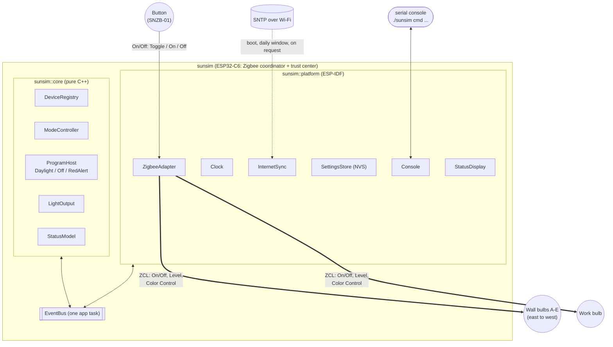
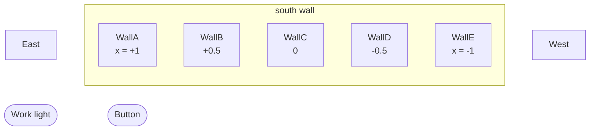
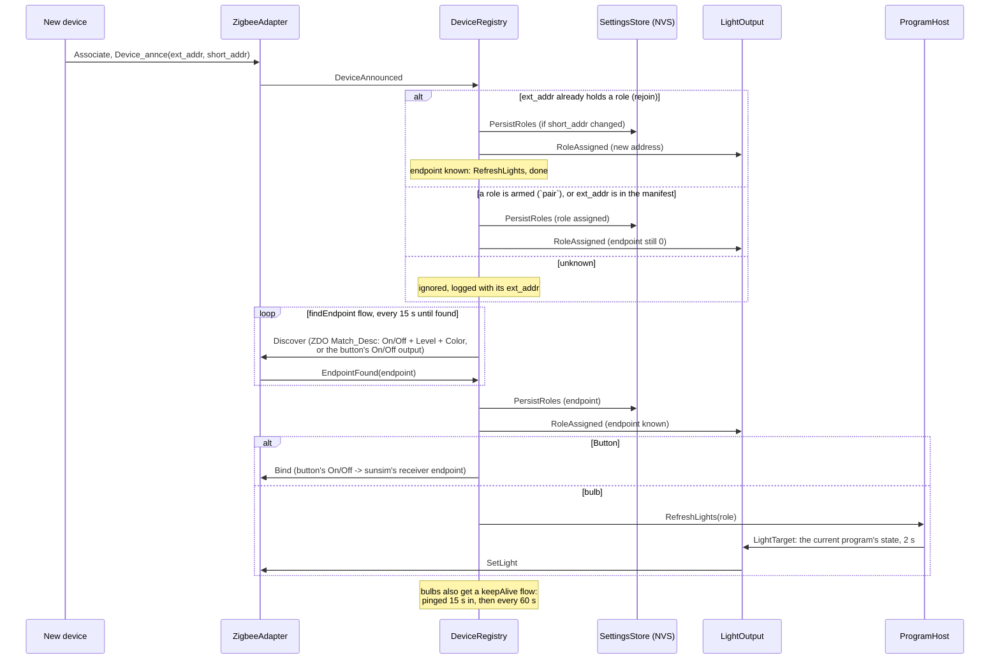
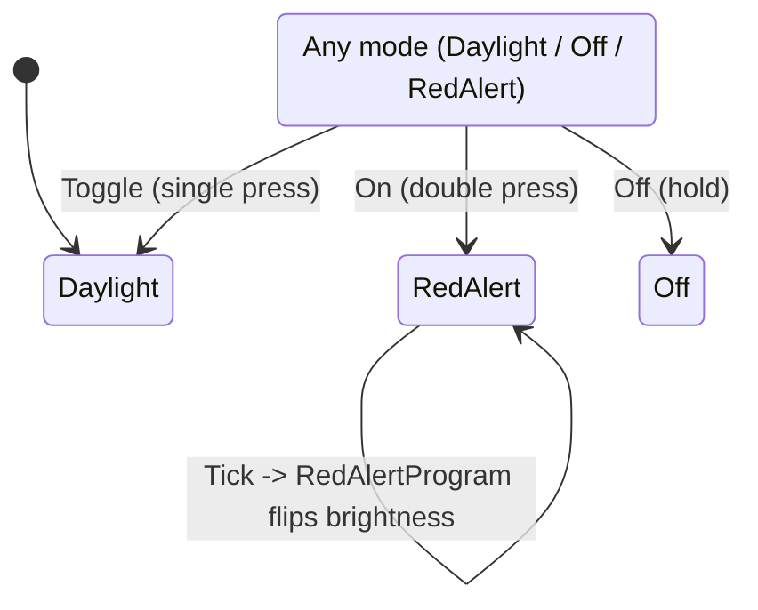
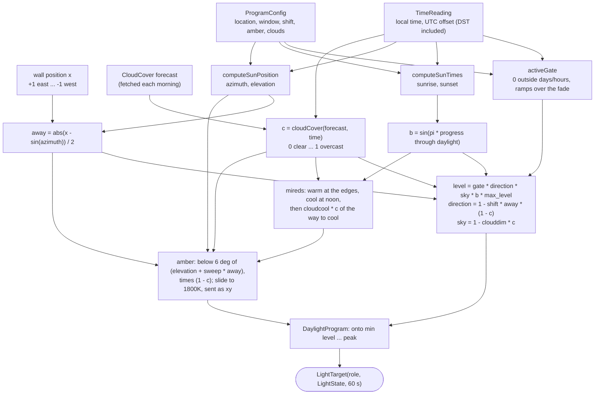

# sunsim — Design

Architecture, addressing, and the math behind the daylight program. For
build/pairing/configuration instructions, see [README.md](README.md).

## 1. System overview



Every module talks only through events on one `EventBus`, processed by a
single app task that holds the Zigbee lock, so no module takes locks or
calls another. `sunsim::core` holds all the application logic and builds on
the host (`test/host`); `sunsim::platform` is everything that touches
ESP-IDF. [ARCHITECTURE.md](ARCHITECTURE.md) has the modules, class
diagrams, threads, events and the boot sequence.

### The wall



The roles come from one table, `ev::kLayout` (`types.cppm`): Wall 5, Work
1, Button 1. A wall light's letter is its place: light `i` of `n` sits at
`x = 1 - 2i/(n-1)`. Changing the count there is all it takes for a
different wall: the role names, positions, the display's dots and the
manifest checks follow at compile time.

## 2. Device addressing & role assignment

Each device carries two addresses and exposes a role through none of them
directly — see the table below, then the join sequence.

| Identifier | Size | Origin | Stable? |
|---|---|---|---|
| `ext_addr` (IEEE/EUI-64) | 64-bit | Burned in at manufacture; printed as a barcode/QR on the device/box | Yes — never changes |
| `short_addr` (NWK address) | 16-bit | Assigned by sunsim (the trust center) when the device associates | No — can change on every rejoin |
| `endpoint` | 8-bit | Discovered via a ZDO Match_Desc query, not announced by the device | Fixed per device/firmware, but not knowable up front |

Role (`WallA`-`WallE`, `Work`, `Button`: a group and an index within it,
`ev::Role`, with the counts per group in `ev::kLayout`) comes from none of these.
It's assigned when the device joins: to the role armed with the console's
`pair <role>` (if the device doesn't already hold one), or else by looking
up `ext_addr` in the optional build-time table
[`main/role_manifest.json`](main/role_manifest.json). Pairing order never
matters.

The manifest is keyed by role name and checked against `ev::kLayout` at
compile time (`DeviceRegistry::manifestOf`): a name the layout doesn't
have, a role listed twice or an address given to two roles fails the
build. So `kLayout` is the only thing to change for a bigger or smaller
wall; the names, positions, display dots and manifest checks follow.



`short_addr` is deliberately never put in the manifest or treated as
stable — it's refreshed from the announce signal every time, exactly as a
network-assigned address should be.

### Finding `ext_addr` when the device has no visible label

Not every bulb prints its IEEE address anywhere accessible. An
unrecognized device is ignored rather than given a role, and its join
attempt logs the exact address you need:

```
W (12345) REGISTRY: Ignoring unknown device 0x1a2b (ext=0x00124b00223344aa): not in role manifest (use `pair <role>` to claim it)
```

(`pair <role>` from the console is usually simpler: it gives the next
device that joins that role.) For the manifest: open `./sunsim monitor`,
put one bulb into pairing mode at a time
(so you know which log line is which physical device), copy the `ext=`
value into the right role's entry in `role_manifest.json`, rebuild/reflash, then
re-trigger pairing on that bulb so it rejoins and matches.

## 3. Button input handling

The SNZB-01-style button tells us which press it was through the standard
On/Off cluster: single = `Toggle`, double = `On`, hold = `Off`. It sends
these to the coordinator's endpoint 1 (our light-control endpoint, which
has no On/Off server) whatever the binding says, so the stack would drop
them. `ZigbeeAdapter::handleApsIndication` (an APSDE-DATA.indication hook)
therefore picks frames from the paired button's short address out before
ZCL processing and dispatches by command id, consuming them.



Fallback for buttons that do send to the bound receiver endpoint 2: the
stack resolves `On`/`Off`/`Toggle` internally and only surfaces the
resulting On/Off attribute (`EZB_ZCL_CORE_SET_ATTR_VALUE_CB_ID`), where
`On` and `Toggle` look the same, so single vs. double press is resolved by
timing (450ms, resolved on the next `Tick` — `core::ModeController`);
`OffWithEffect` and Scenes `RecallScene` are handled directly.

## 4. Daylight mathematical model

No Zigbee or hardware dependency in either piece below
(`components/sunsim_core/src/math/daylight.cppm`, `solar.cppm`) — both are pure
functions, unit-testable on the host.

How one wall light's target is made, every `ProgramTick` (60 s), from the
time and the light's place on the wall:



The work light skips the sun: its level is `gate * max_level` and its
color follows the work hours (below).

### Wall bulbs (`DaylightSchedule::wallState`)

The window the half-sine curve runs across is now the **real** sunrise/
sunset for the configured location and date, not a fixed clock-time guess.
Let `h` be the fractional hour of day (`hour + minute/60 + second/3600`),
`sunrise`/`sunset` the result of `computeSunTimes()` (§5) for today, and
(if `sunset <= sunrise`, i.e. the window spills past local midnight —
see the near-polar-summer case in §5) unwrapped onto a continuous scale.
Off outside `[sunrise, sunset]`; inside it:

```
p = (h - sunrise) / (sunset - sunrise)      # 0..1 progress through today's daylight window
b = sin(π · p)                              # 0 at sunrise/sunset, 1 at solar noon

level  = round(gate · direction · b · max_level), floored to min_level
mireds = round(warm_mireds - b · (warm_mireds - cool_mireds))
```

(`gate` is the active window, below; `direction` the sun's side of the
wall, next.)

`b` is a half-sine: it starts and ends at 0 (sunrise/sunset) and peaks at 1
exactly at the window's midpoint ("solar noon" for that day's actual window
length). Brightness (`level`) scales directly with `b`; color temperature
(`mireds`) is a linear interpolation between `warm_mireds` at the edges
(`b=0`) and `cool_mireds` at the peak (`b=1`) — lower mireds is
cooler/bluer, so the light goes warm-and-dim at the edges to
cool-and-bright at midday, and the whole curve stretches or compresses
with the real day length through the year.

Defaults: `warm_mireds=370` (~2700K), `cool_mireds=153` (~6500K),
`min_level=1`, `max_level=254`.

### Sun direction along the wall

The wall bulbs sit east-to-west along the south wall, lettered from the
east, evenly spaced: with five, A at the east end (`x = +1`), then B
(`+0.5`), C in the middle (`0`), D (`-0.5`) and E at the west end (`-1`);
in general bulb `i` of `n` sits at `x = 1 - 2i/(n-1)`.
`computeSunPosition()` (NOAA solar position equations, in `solar.cppm`)
gives the sun's compass azimuth; its east-west component
`sun_x = sin(azimuth)` is +1 due East, 0 due South, -1 due West. Each wall
bulb's level is then scaled by

```
away      = |x_bulb - sun_x| / 2                  0 under the sun, 1 at the opposite end
direction = 1 - k · away                          k = sun_shift_percent / 100 (default 0.25)
```

so the bulb under the sun gets the full curve and the far end down to
`1 - k`. It only ever dims, so `intensity` peaks stay true maxima. Seasons
fall out of the real azimuth: in June the sun rises NE (~57°) and sets NW
(~303°), so A and E lead strongly at the ends of the day; in December it
rises SE (~123°) and sets SW (~238°) and the middle leads for longer.

### Amber sunrise/sunset

Below `golden_elevation_deg` (6°) of sun elevation, the wall color slides
along the blackbody (Planckian) locus from the curve's value down to
`amber_kelvin` (1800K) at the horizon:

```
e      = elevation + amber_sweep_deg · away       amber_sweep_deg default 3°
g      = min(1, (6° - e) / 6°)
mireds = curve_mireds + g · (1e6/1800 - curve_mireds)
```

The glow follows the sun along the wall: each bulb sees the sun as if it
were up to `amber_sweep_deg` higher the further away it is, so the end
nearest the sun turns amber first and deepest and the color sweeps across
the wall. At sunset in June at the equator (sun ~293°) the five bulbs land
at about 2400K (east end) through 1980K (west end); at sunrise it runs the
other way. `amber_sweep_deg = 0` turns the whole wall amber together.

Most bulbs' color-temperature mode stops around 2700K, so in this band the
color is sent as CIE 1931 xy (`BulbEndpoint::setColorXY`, Kim et al.
Planckian-locus approximation) instead; the rest of the day stays in
color-temperature mode, which renders whites with the dedicated white
LEDs. On a winter weekday this is visible from ~15:40 to sunset (~16:22).

### Work bulb (`DaylightSchedule::workState`)

Bright, and **cool to warm** across the core work hours (`work`, a
`DaySpan`, default 08:30-17:30, inside the longer 08:00-19:00
active window it's on for) rather than tied to the sun: cool, blue-rich light in the morning supports alertness and
circadian entrainment, while blue-rich light in the evening suppresses
melatonin and delays sleep (cf. the evening-light guidance in Brown et
al., PLOS Biology 2022). With `p` the progress through the work hours (so it holds cool before
them and warm after):

```
p      = clamp((h - work_start) / (work_end - work_start), 0, 1)
level  = gate · max_level
mireds = work_cool_mireds + p² · (work_warm_mireds - work_cool_mireds)
```

Defaults: `work_cool_mireds=167` (~6000K), `work_warm_mireds=333`
(~3000K). The ease-in (`p²`) keeps it near-cool through the morning
(~5200K at noon) and warms most steeply in the afternoon (~3900K at
15:00), reaching ~3000K at 17:30 and holding there until the light turns
off. Interpolating in mireds rather than kelvin
keeps the steps perceptually closer to even.

### Cloud cover (`core::SkyModel`, `sky_model.cppm`; `cloudCover()`, `sky.cppm`)

Every 15 minutes the internet sync (§5) fetches Open-Meteo's `current`
cloud cover for the configured location (15-minute model data: in the US,
HRRR's) and posts it as `ConditionsUpdated`; that's `c` while it's under
45 minutes old (`kWeatherFreshFor`). Failing that, the daily sync's hourly
forecast: a `CloudCover`, 48 local hours from 00:00 of the day it was
fetched, which `cloudCover()` interpolates linearly between hours.
`SkyModel` decides which applies and posts it in `SkyChanged`, to the
percent. Either way `c` runs 0 (clear) to 1 (overcast); no data means
clear. The
wall then gets what an overcast sky gives a room - less light, cooler,
from everywhere at once:

```
sky        = 1 - (clouddim / 100) · c              default clouddim 40
direction  = 1 - k · away · (1 - c)                no sun direction under overcast
mireds    += (cool_mireds - mireds) · (cloudcool / 100) · c    default cloudcool 50
golden    *= 1 - c                                 no golden glow under a gray sky
```

The work light is task lighting and ignores the sky. In fast-day mode the
simulated day reads the forecast's first day, never the live reading, so
the sped-up loop shows today's sky. `config clouds off` ignores both.

### Weather lights (`core::Overlays`, `overlays.cppm`)

The same 15-minute fetch reads the WMO weather code (what's falling, and
how hard) and NWS's active alerts for the location. `Overlays`, between the
programs and `LightOutput`, re-checks them every Tick and has chosen lights
pulse, like red alert: a fade each `fade_seconds`, between

```
top    = 254 · peak / 100 · strength       (at least the light's minimum)
bottom = top · 0.2                         (likewise)
```

| What | Color (hue°, sat/254) | Fade | strength |
|---|---|---|---|
| NWS warning | red (0, 254) | 1 s | 1 |
| NWS watch | orange (28, 254) | 2 s | 1 |
| NWS advisory | yellow (50, 254) | 3 s | 1 |
| rain | deep blue (228, 254) | 2 s | 0.6 / 0.8 / 1 by intensity |
| drizzle | pale blue (205, 170) | 3 s | 〃 |
| snow | ice blue (195, 150) | 3 s | 〃 |
| freezing rain | violet (280, 230) | 2 s | 〃 |
| thunderstorm | purple (270, 254) | 1 s | 〃 |

An alert's tier is its event name's last word (Warning / Emergency, Watch,
Advisory); other statements count only if NWS marks them Extreme (warning)
or Severe (watch). Which lights, and when, is in ARCHITECTURE.md §5; rain
or snow on a light that's otherwise off shows at 0.35 of the strength.

### Per-light range: minimum level to peak (`core::DaylightProgram`)

After the schedule computes a bulb's level (`min_level` ... `max_level`,
1 ... 254), `DaylightProgram` maps it onto that light's own range: from its
**minimum level** (`minlevel`, raw 1-254, NVS `<role>.min`, default 1) up to
its **peak** (`intensity`, % of full, NVS `<role>.peak`, defaults walls 100
/ work 90):

```
top       = 254 · peak / 100
f         = (level - min_level) / (max_level - min_level)
level_out = round(minimum + (top - minimum) · f)
```

So `peak` is the brightness at the curve's maximum (solar noon for wall
bulbs, mid-window for the work bulb), and the dim end stops at the lowest
level the bulb visibly shows instead of fading below it: bulbs stay lit
until the curve really ends (sunset, or the active window's end), then
turn off. Find the minimums with tuning mode (`TuningProgram`: every bulb
steady at its minimum in the sunset's amber; `tune <light> <level>`, then
`tune save`). Color is untouched; red alert is not scaled.

### Active window (`DaylightSchedule::activeGate`)

Both bulb types are gated by one shared window, set with the `config`
console command and persisted in NVS (`platform::SettingsStore`):
on only on `active_days` (a `Weekdays` set, default Mon–Fri) in the
`active` hours (a `DaySpan`, default 08:00–19:00), off otherwise. Inside
it, a gate factor ramps over `fade` (default 10 min) at each edge:

```
gate = 0                                               outside days/hours
gate = min(1, (h - start)/fade, (end - h)/fade)        inside
level_out = round(gate · level), floored to min_level while gate > 0
```

Only brightness is scaled; color temperature still follows the sun. The
sun curve still applies inside the window, so in winter the wall bulbs go
dark at real sunset even before the active hours end.

## 5. How location is provided

Two independent, decoupled pieces feed into the wall bulbs' sunrise/sunset
calculation — no GPS, just two numbers you configure once:

1. **Latitude/longitude** (`CONFIG_SUNSIM_LATITUDE_DEG`/
   `CONFIG_SUNSIM_LONGITUDE_DEG`, decimal degrees, North/East positive) —
   set via `menuconfig`, parsed with `strtod()` in `App`'s (`main/main.cpp`)
   constructor, and stored in `ev::ProgramConfig`.
   The same location is used for the cloud-cover forecast (§4).
2. **Local civil UTC offset** — needed alongside longitude because the
   calculation has to know which UTC instant "today, local time" actually
   is. `InternetSync` sets the clock to UTC over SNTP (at boot, then in the
   daily sync window); from there, `platform::Clock` derives the offset in effect
   now (DST included; `utcOffset()` in `zone.cppm`, the one place that
   touches `std::tm`) without a portable `tm_gmtoff` field (not
   available on this toolchain's `struct tm` — confirmed by test
   compile): it takes the current instant's local calendar fields
   (`localtime_r`, under the process's `TZ`, `CONFIG_SUNSIM_TZ`), reads
   them back as if they were UTC (`std::chrono::sys_days`), and the
   difference from the instant itself is the offset. (An earlier version
   fed `gmtime_r`'s fields to `mktime()`; `gmtime_r` sets `tm_isdst = 0`,
   so that always gave the standard offset and put every sunrise/sunset an
   hour early under DST.) Everything past the clock works in `<chrono>`:
   a `TimeReading` is a `std::chrono::local_seconds` plus that offset, and
   gives its day, weekday, day of the year and time since midnight.

`solar.cppm` implements the "Sunrise/Sunset Algorithm" from the
*Almanac for Computers, 1990* (Nautical Almanac Office, US Naval
Observatory) — the standard non-iterative closed-form approximation used
by most embedded sunrise/sunset libraries (accurate to within a couple of
minutes). Given latitude, longitude, day-of-year (`TimeReading::dayOfYear()`), and
the UTC offset above, it returns local sunrise/sunset as `ev::Hours`
(fractional hours after midnight).
Validated on the host against known reference times before wiring it in
(equinox ≈ 06:00/18:00 everywhere; London ≈ 04:43/21:21 at the summer
solstice and ≈ 08:04/15:53 at the winter solstice; Reykjavik's much longer
summer days and short winter days; Southern-hemisphere seasons correctly
inverted).

At latitudes inside the polar circle, the day can have no sunrise/sunset at
all, or the sunset can land after local midnight (summer, very long day).
`solar.cppm` clamps the underlying angle rather than leaving a domain error
(degenerates to an always-off or always-on day instead of propagating NaN
into bulb commands); `daylight.cppm`'s window math unwraps a
`sunset <= sunrise` case onto a continuous scale so hours just after
midnight are still correctly treated as part of the previous evening's
daylight window.

Work hours (§4) remain fixed local-clock thresholds, by design — they're
your work schedule, not a daylight simulation, so there's nothing to
compute.

## 6. Smooth transitions

Every periodic update (`ProgramTick` -> `DaylightProgram`, driven by the
clock) sends level/color commands with a transition equal to the update
interval (60 s normally, 1 s in debug fast-day mode), so bulbs fade
continuously rather than stepping. Changes that should feel immediate —
resuming after an override, a bulb finishing discovery or answering
again, the network coming up, a setting change — re-apply with a fixed 2 s
transition (`Program::refresh`). `LightOutput` only sends what changed, so
a steady light gets no traffic at all.

## 7. File layout

See the [Layout section in README.md](README.md#layout).
