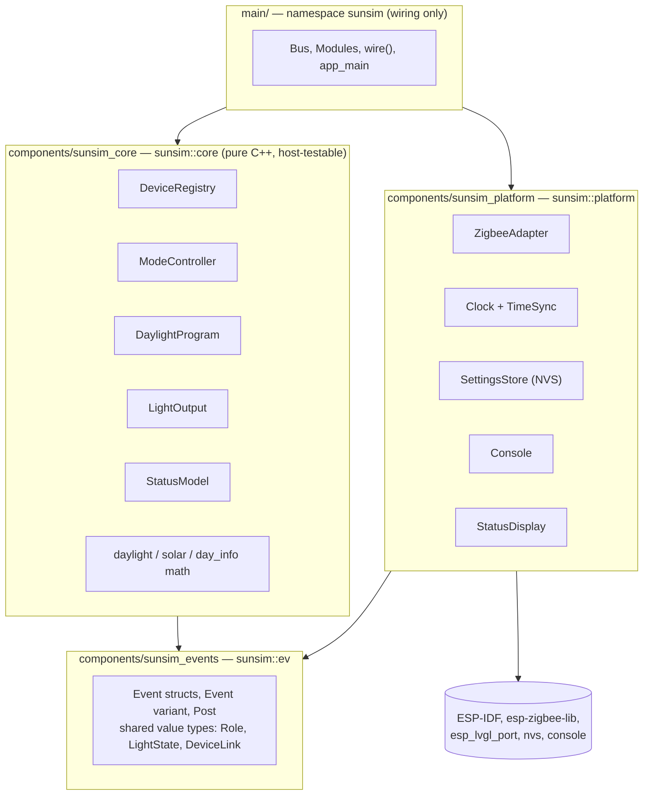
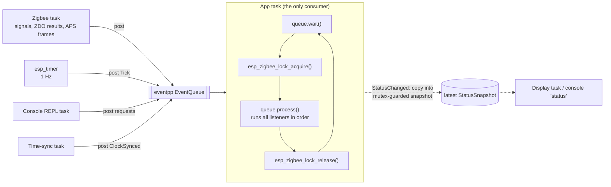
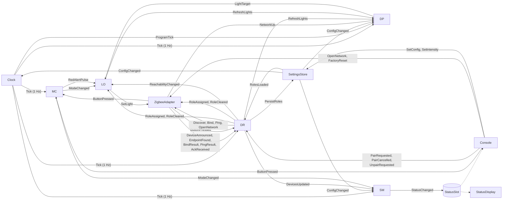
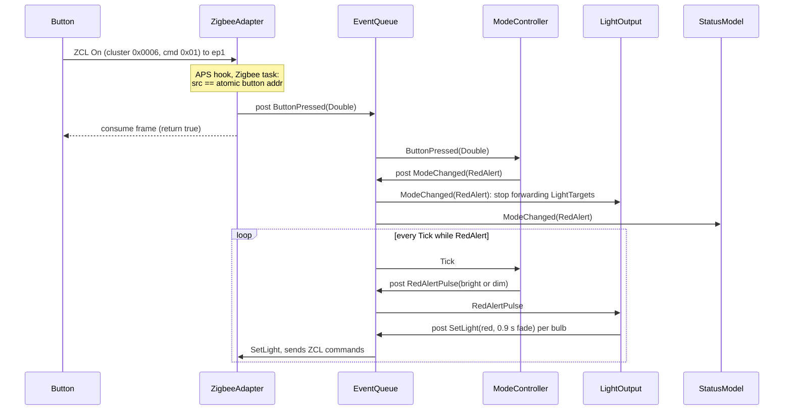

# sunsim — event-driven architecture

**Status:** implemented (branch `feature/event-bus`). §1 describes the code
as it was before; §2-§8 the architecture as built; §9 measurements; §11
where the build differs from the original proposal. Domain details (pairing,
the daylight math) are in [DESIGN.md](DESIGN.md).

## 1. Why

The behaviour was in good shape; the structure had three pain points:

1. **Too many execution contexts touch app state.** The Zigbee task, the
   `esp_timer` heartbeat, the console REPL, the display task, the time-sync
   task and the LVGL task all read or write `LightRig`/`ButtonController`
   state, kept safe by hand-placed `esp_zigbee_lock_acquire()` calls and
   comment-level rules (`ButtonController`'s "do NOT take the lock here").
2. **`LightRig` does six jobs**: pairing, endpoint discovery, liveness,
   scheduling, intensity scaling, and Zigbee command output.
3. **`SunsimApp::heartbeatTick` multiplexes unrelated cadences** with
   counters (button timing, daylight updates, 15 s discovery retry, 60 s
   ping, red-alert pulse), and the console/display reach into internals.

The fix is one rule: **producers post events; a single app task
processes them.** Modules never take locks and never call each other.

## 2. Layers and namespaces

Namespaces label layers; ESP-IDF component `REQUIRES` lines enforce them
(a `core` file that includes `esp_zigbee.h` fails to build).



| Namespace | Holds | Depends on |
|---|---|---|
| `sunsim::ev` | Event payload structs, `Event` variant, `Post`; shared value types (`Role`, `LightState`, `DeviceLink`, `Mode`) | nothing |
| `sunsim::core` | `DeviceRegistry`, `ModeController`, `DaylightProgram`, `LightOutput`, `StatusModel`, existing pure math | `ev` |
| `sunsim::platform` | `ZigbeeAdapter`, `Clock`/`TimeSync`, `SettingsStore`, `Console`, `StatusDisplay` | `ev`, ESP-IDF |
| `sunsim` | `Bus`, `Modules`, `wire()`, `app_main` | all |

Conventions: at most two levels (`sunsim::core::X`); anonymous namespaces
for file-private helpers (as today); `detail` only for header-visible
internals such as eventpp policy structs. `core` and `platform` never
include each other — anything both need lives in `ev`.

## 3. Threading model



- **All module code runs on the app task**, which holds the Zigbee lock for
  the whole batch, so handlers may issue Zigbee commands directly.
- `EventQueue` releases its internal mutex before invoking listeners, so a
  Zigbee callback posting (already under the Zigbee lock) while the app
  task is processing cannot deadlock.
- **Two deliberate synchronous edges** remain, both tiny:
  1. The APS hook must decide *immediately* whether to consume a frame.
     `ZigbeeAdapter` keeps the button's short address in an
     `std::atomic<uint16_t>` (updated on `RoleAssigned{Button}`) and posts
     `ButtonPressed` for matching frames.
  2. Readers outside the app task (console `status`, display) read the
     last `StatusSnapshot`, which a `StatusChanged` listener copies into a
     mutex-guarded slot. Nothing else crosses threads.

## 4. Modules and event flow



| Module | Replaces | Listens to | Posts |
|---|---|---|---|
| **ZigbeeAdapter** — the only code including esp-zigbee | `SunsimApp`'s signal/ZCL/APS handlers, ZDO calls in `LightRig`, `BulbEndpoint` | `SetLight`, `Discover`, `Bind`, `Ping`, `OpenNetwork`, `FactoryReset`, `RoleAssigned`, `RoleCleared` | `NetworkUp`, `DeviceAnnounced`, `EndpointFound`, `BindResult`, `PingResult`, `AckReceived`, `ButtonPressed` |
| **DeviceRegistry** | `RoleStore`; pairing, discovery retry, liveness in `LightRig` | `RolesLoaded`, `DeviceAnnounced`, `EndpointFound`, `BindResult`, `PingResult`, `AckReceived`, `ButtonPressed`, `PairRequested`, `PairCancelled`, `UnpairRequested`, `Tick` | `RoleAssigned`, `RoleCleared`, `Discover`, `Bind`, `Ping`, `OpenNetwork`, `PersistRoles`, `RefreshLights`, `ReachabilityChanged`, `DevicesUpdated` |
| **ModeController** | `ButtonController` | `ButtonPressed`, `Tick` | `ModeChanged`, `RedAlertPulse` |
| **DaylightProgram** | `DaylightSchedule` use, peaks, clock guard in `LightRig` | `ConfigChanged`, `Tick`, `ProgramTick`, `RefreshLights`, `NetworkUp` | `LightTarget` |
| **LightOutput** | applied-state cache and apply logic in `LightRig` | `LightTarget`, `ModeChanged`, `RedAlertPulse`, `RoleAssigned`, `RoleCleared`, `ReachabilityChanged` | `SetLight`, `RefreshLights` |
| **StatusModel** | `status.cpp` | `ConfigChanged`, `ModeChanged`, `DevicesUpdated`, `Tick` | `StatusChanged` |
| **Clock** | heartbeat timer and counters, `FastDayClock`, `WifiTimeSync` | `Heartbeat`, `ConfigChanged` | `Heartbeat` (from its timer), `Tick`, `ProgramTick` |
| **SettingsStore** | `schedule_settings`, `RoleStore` persistence | `SetConfig`, `SetIntensity`, `PersistRoles`, `FactoryReset` | `RolesLoaded`, `ConfigChanged` |
| **Console** | `pairing_console` | — (REPL task; reads `StatusSlot`) | requests above |
| **StatusDisplay** | `status_display` | — (display task; reads `StatusSlot`) | — |

`LightOutput` owns the "what's the bulb's address" map, built from
`RoleAssigned`, so `SetLight` carries a network address and
`ZigbeeAdapter` never needs to know about roles (except the button's
address for the synchronous APS decision).

## 5. Event catalogue (`sunsim::ev`, `events.h`)

| Event | Payload | Posted by |
|---|---|---|
| `Heartbeat` | — | Clock's 1 Hz esp_timer |
| `Tick` | uptime, `TimeReading` (local time, UTC offset, valid, simulated) | Clock (1 Hz) |
| `ProgramTick` | `TimeReading`, transition | Clock (60 s, or 1 s in fast-day) |
| `ConfigChanged` | `ProgramConfig`, per-light `Peaks` | SettingsStore (at boot, then on change) |
| `SetConfig` / `SetIntensity` | `ProgramConfig` / role (or all) + % | Console |
| `RolesLoaded` / `PersistRoles` | all `DeviceRecord`s | SettingsStore / DeviceRegistry |
| `NetworkUp` | rejoined | ZigbeeAdapter |
| `DeviceAnnounced` | ext addr, short addr | ZigbeeAdapter |
| `EndpointFound` | role, endpoint (0 = not found) | ZigbeeAdapter |
| `BindResult` / `PingResult` | role, ok (+ error, status) | ZigbeeAdapter |
| `AckReceived` | short addr, RSSI, ZCL status | ZigbeeAdapter |
| `ButtonPressed` | `Single` / `Double` / `Hold` / `Ambiguous`, source, time | ZigbeeAdapter, Console |
| `PairRequested` / `PairCancelled` / `UnpairRequested` | role (or all) | Console |
| `OpenNetwork` | seconds | Console, DeviceRegistry |
| `FactoryReset` | — | Console |
| `RoleAssigned` / `RoleCleared` | role (+ `DeviceRecord`) | DeviceRegistry |
| `Discover` / `Bind` / `Ping` | role, short (+ ext, endpoint for bind) | DeviceRegistry |
| `ReachabilityChanged` | role, reachable | DeviceRegistry (a bulb stopped answering / answers again) |
| `DevicesUpdated` | per-role `DeviceStatus`, records, armed role | DeviceRegistry (1 Hz) |
| `ModeChanged` | `Mode` | ModeController |
| `RedAlertPulse` | bright/dim | ModeController |
| `RefreshLights` | role (or all) | DeviceRegistry, LightOutput, wiring (`NetworkUp`) |
| `LightTarget` | role, `LightState`, transition | DaylightProgram |
| `SetLight` | short, endpoint, optional power/level/mireds/xy/hue-sat, transitions | LightOutput |
| `StatusChanged` | `shared_ptr<const StatusSnapshot>` | StatusModel (1 Hz) |

## 6. Key flows

### Button double press → red alert



### Pairing a bulb from the console

```mermaid
sequenceDiagram
    participant U as Console
    participant Q as EventQueue
    participant DR as DeviceRegistry
    participant ZA as ZigbeeAdapter
    participant LO as LightOutput
    participant D as Bulb

    U->>Q: post PairRequested(WallC)
    Q->>DR: arm WallC
    DR->>Q: post OpenNetwork(180)
    Q->>ZA: permit join
    D->>ZA: joins, Device_annce
    ZA->>Q: post DeviceAnnounced(ext, short)
    Q->>DR: unassigned device + armed role: assign WallC, persist
    DR->>Q: post RoleAssigned(WallC, endpoint 0) and Discover(WallC)
    Q->>ZA: Match_Desc
    ZA->>Q: post EndpointFound(WallC, 1)
    Q->>DR: persist endpoint
    DR->>Q: post RoleAssigned(WallC, endpoint 1)
    Q->>LO: address known; next LightTarget for WallC is sent
```

### Daylight update

`Clock` → `ProgramTick` → `DaylightProgram` computes a `LightTarget` per
light (sun curve, active window, sun shift, amber, peak %) →
`LightOutput` (if mode is `Auto` and the address is known, diffed against
its applied-state cache) → `SetLight` → `ZigbeeAdapter`.

## 7. Wiring

```cpp
// sunsim_events: one variant; an event's type id is its index in it.
namespace sunsim::ev {
using Payload = std::variant<Heartbeat, Tick, ProgramTick, /* ... */ StatusChanged>;
struct Event {
    Payload data;
    template <class T> Event(T &&payload);          // implicit: post(ev::Tick{...})
    template <class T> const T &as() const;
};
template <class T> inline constexpr std::size_t kTypeId = /* index of T in Payload */;
using Post = std::function<void(Event)>;            // what every module gets

class EventBus {                                    // wraps eventpp::EventQueue<size_t, void(const Event&)>
public:
    template <class T, class F> void on(F listener); // bus.on<Tick>([&](const Tick &t) { ... });
    const Post &post() const;
    void wait(); bool process(); void drain();
};
} // namespace sunsim::ev

// sunsim_core (core.cpp): every core-to-core edge, shared by firmware and tests.
void wireCore(ev::EventBus &bus, CoreModules &m)
{
    bus.on<Tick>([&](const Tick &e) { m.mode.onTick(e); m.registry.onTick(e); m.program.onTick(e); m.status.onTick(e); });
    bus.on<ButtonPressed>([&](const ButtonPressed &e) { m.registry.onButtonPressed(e); m.mode.onPress(e); });
    bus.on<LightTarget>([&](const LightTarget &e) { m.output.onTarget(e); });
    // ...
}

// main (app.cpp): the platform edges.
void App::wirePlatform()
{
    bus_.on<SetLight>([this](const SetLight &e) { zigbee_.onSetLight(e); });
    bus_.on<PersistRoles>([this](const PersistRoles &e) { settings_.onPersistRoles(e); });
    // ...
}
```

Modules receive a `Post` at construction, never a bus or another module.
`EventBus::enqueue` logs every event at DEBUG (tag `EV`), giving a full
trace of the system's behaviour when needed.

## 8. Testing

`test/host/` builds `sunsim_events` + `sunsim_core` with plain CMake on the
host (no ESP-IDF; exceptions/RTTI off like the firmware) and wires them
with the same `wireCore()`. Each test posts events and asserts on
everything posted in response:

```
cmake -S test/host -B build-host && cmake --build build-host && ./build-host/sunsim_tests
```

Covered: console pairing end to end; a paired device is never re-claimed by
`pair`; unknown devices ignored; double press -> red pulses -> single press
re-syncs; hold -> all off and targets ignored; ambiguous On/Toggle timing;
clock-not-set holds lights off; per-light intensity scaling; liveness
(acks -> online, silence -> silent, pings every 60 s); discovery retry every
15 s; button pairing binds and is never driven as a bulb; `unpair all`.

## 9. eventpp on ESP-IDF — measured

- Builds for ESP32-C6 with C++ exceptions **and** RTTI disabled (checked
  standalone before adoption, and in the firmware).
- Vendored under `components/eventpp` (commit `1224dd6`, headers only).
- Standalone bus benchmark: eventpp's own cost ~3.6 KB flash over a
  hand-rolled mutex+deque bus; host stress test (2 producer threads,
  140k events, ThreadSanitizer) clean.
- Whole firmware vs `master` with the same sdkconfig: **+24 KB flash,
  +1.5 KB static RAM** (1.27 MB vs 1.25 MB of a 4 MB app slot).
- `EventQueue::process()` swaps the pending list out under its mutex and
  dispatches without holding it, so producers never block on listeners.
- An `Event` is as large as its largest payload, and posting copies it a few
  times on the poster's stack. `StatusChanged` therefore carries a
  `shared_ptr` (Event: ~496 -> ~256 bytes), and every posting task has room:
  main 6 KB, esp_timer 4.5 KB, Zigbee 6 KB, console 6 KB, app 8 KB.
- Alternative considered: ESP-IDF's `esp_event` (C-only, memcpy'd POD
  payloads, no host build) - rejected for typed events and host testing.

## 10. Migration

Done in one branch rather than six shippable steps: the module split made
the intermediate states (half events, half direct calls) more work than
the end state. Persisted data is unchanged (same NVS keys), so existing
pairings and settings carry over; verified on the board (restored roles,
real button presses, console commands, status).

## 11. Differences from the original proposal

- **No separate type enum:** an event's id is its index in the `Payload`
  variant (`kTypeId<T>`), so the two can't drift apart.
- **`Heartbeat`** added: the esp_timer only posts it; the Clock reads the
  time on the app task (so the fast-day clock can follow `ConfigChanged`
  without a lock).
- **`ClockSynced` dropped:** `Tick`/`ProgramTick` carry a `TimeReading`
  with a `valid` flag (year >= 2024), which is all consumers needed.
- **`LinkChanged` -> `DevicesUpdated`:** one 1 Hz summary from the
  registry; `StatusModel` publishes right after it, so links are current.
- **`RefreshLights`** added: "re-apply now with a 2 s transition", posted
  on resume, rejoin, endpoint found; `ConfigChanged` re-applies too (so
  `config`/`intensity` changes now show within 2 s, not at the next update).
- **Wi-Fi credentials** stay direct NVS calls from the console (no
  `SetWifi`): they're only read by the time-sync task at connect time.
- **`wireCore()` lives in `sunsim_core`** so tests and firmware share it;
  only platform edges are in `main/app.cpp`.

- **Missing devices are tolerated** (added after the first build): sending
  to an unreachable bulb ties up the stack's buffers with retries; in
  fast-day mode that made ~20% of all light commands fail to queue and
  starved other traffic. `DeviceRegistry` now marks a bulb unreachable on a
  failed ping plus 60 s of silence (first ping 15 s after boot), posts
  `ReachabilityChanged`, and `LightOutput` pauses it until it answers again
  (pinged every 15 s meanwhile), then re-applies its light. `LightOutput`
  also only re-sends values that changed. `ZigbeeAdapter` logs a summary of
  any commands the stack refuses to queue.

## 12. Open questions

- Is one queue enough, or should time-critical `SetLight` traffic bypass
  queued diagnostics? At current rates (a few events/s) one queue is ample.
- Persisting from `DeviceRegistry`/`SettingsStore` touches NVS from the app
  task (while it holds the Zigbee lock); fine at today's write rates,
  revisit if writes become frequent.
- `DevicesUpdated` is now the largest payload (~250 B), setting every
  Event's size; share it like `StatusChanged` if events grow further.
- (Resolved) `Tick`/`ProgramTick` carry the program time, so fast-day mode
  is purely a Clock concern.
